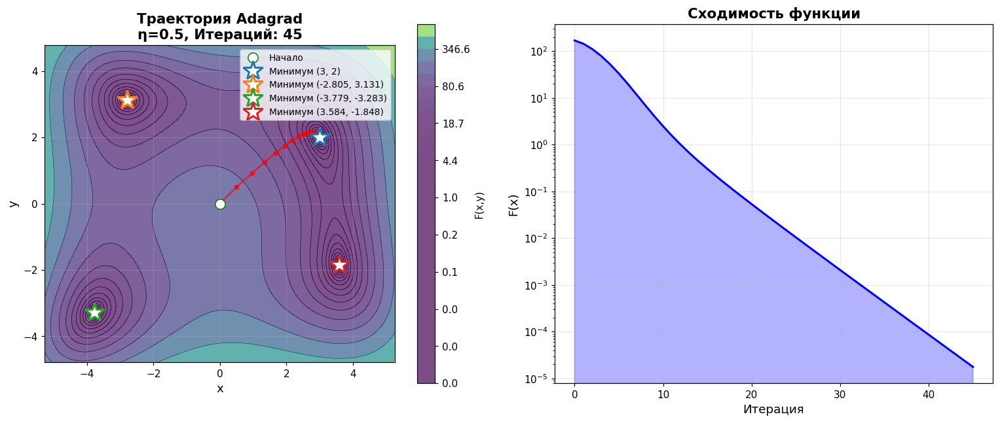

# Adagrad и RMSprop

Учебная работа по методам оптимизации. Сравнение двух способов адаптивного выбора шага градиентного спуска на функциях Химмельблау, Розенброка и Матьяса.

**Python, NumPy, Matplotlib.**

## Что делает программа

- Вычисляет градиент центральными конечными разностями.
- Выполняет итерации Adagrad или RMSprop.
- Выводит координаты точки, значение функции, адаптивный шаг и критерии остановки.
- Строит траекторию на линиях уровня, график изменения функции и анимацию движения точки.

Adagrad накапливает сумму квадратов градиентов, а RMSprop использует их экспоненциальное скользящее среднее. Начальная точка, шаг и точность задаются в конце каждого файла.

## Файлы

| Функция | Adagrad | RMSprop |
|---|---|---|
| Химмельблау | `adagrad_himmelblau.py` | `rmsprop_himmelblau.py` |
| Розенброка | `adagrad_rosenbrock.py` | `rmsprop_rosenbrock.py` |
| Матьяса | `adagrad_matyas.py` | `rmsprop_matyas.py` |

`adagrad_examples.py` содержит дополнительные примеры Adagrad на функциях Розенброка, Растригина и Химмельблау, включая трёхмерные графики.

## Запуск

Python 3.11:

```bash
python -m pip install -r requirements.txt
python adagrad_himmelblau.py
```

Для другого примера замените имя файла. После закрытия окна с графиками откроется анимация.

## Пример



Пример использует начальную точку `(0, 0)`, шаг `0.5` и точность `1e-4`.

## На что обратить внимание

Остановка происходит при малом изменении координат **или** значения функции. Это не гарантирует достижение глобального минимума. Например, при выбранных настройках RMSprop на функции Розенброка может остановиться раньше, чем приблизится к `(1, 1)`.

В отдельных примерах заданы разные шаги и точности. Чтобы сравнивать методы по числу итераций, нужно сначала согласовать параметры и критерий качества. Для защиты от бесконечного расчёта установлен предел 100000 итераций.
